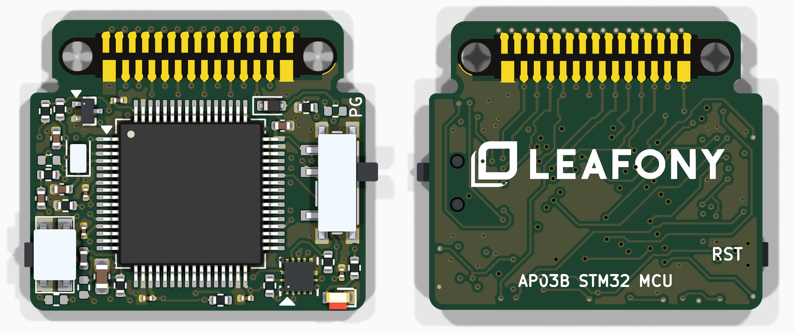

# Leafony AP03B STM32

AP03B STM32は、STM32duinoの既存のボード選択「Leafony AP03」を使用するマイコンリーフです。v1.1ではLQFP64の各GPIOを従来と同じLeafonyバス接点に接続します。

STM32L452RET6を搭載した、Leafony AP03B STM32リーフのハードウェア設計リポジトリです。KiCadの回路図・PCBレイアウト、単体基板のGerber・ドリルデータ、専用ライブラリ、部品表（BOM）を収録しています。

設計を開く場合は [KiCadプロジェクト](./kicad/ap03b-stm32/ap03b-stm32.kicad_pro)、部品を確認する場合は [BOM](./docs/leafony-ap03b-stm32-bom.csv) から参照してください。



## ハードウェア概要

| 項目 | 内容 |
| --- | --- |
| MCU | STMicroelectronics STM32L452RET6（U1） |
| CPU | Arm Cortex-M4、FPU搭載、最大80 MHz |
| メモリ | Flash 512 KB / SRAM 160 KB |
| MCUパッケージ | LQFP64、10 × 10 mm、0.5 mmピッチ |
| 低速外部クロック | 32.768 kHz水晶（X1） |
| 電源 | Leafonyバスの3.3 V / GND |
| バス接点 | CN1、表裏各29接点 |
| 主なバス信号 | D0〜D13、A0〜A5、SDA / SCL、SWDIO / SWCLK、RESET、AREF |
| 操作・表示 | BOOT0切り替えスイッチ、リセットスイッチ、BOOT0状態表示LED |
| 基板 | 外形最大23 × 20 mm、4層、板厚0.8 mm（PCB設計値） |
| 製造仕様 | FR-4、無電解金めっき（ENIG）。L2はGND専用層。L1・L3・L4は信号・電源を配線し、空き領域をGNDで充填。表裏のCN1バス接点のマスク開口部はGND充填の対象外 |
| 配線・ビア | 最小配線幅・間隔は0.15 mm。ビアは外径0.45 mm・穴径0.25 mmのパッド外貫通ビア |
| 設計リビジョン | v1.1、2026-11-20（単体基板・回路図のタイトル欄） |

CPU・メモリの仕様は [STMicroelectronicsの製品情報](https://www.st.com/en/microcontrollers-microprocessors/stm32l452re.html)、実装部品と接続は本リポジトリの回路図・PCB・BOMを参照しています。最大クロックはMCUの仕様値で、実際の動作クロックはファームウェアの設定によります。

CN1のVBUS端子は未接続で、AREFの接続用抵抗R5は未実装（DNP）です。各端子の接続は [Leafonyバス回路図](./kicad/ap03b-stm32/leafony_bus.kicad_sch) と [MCU回路図](./kicad/ap03b-stm32/stm32.kicad_sch) で確認できます。

### スイッチとLED

| 部品 | 型番 | 回路上の役割 |
| --- | --- | --- |
| SW1（PG） | CUS-12TB | BOOT0のHigh / Lowを切り替える |
| SW2（RST） | EVQ-P7B01P | 押すとRESETをGNDへ接続する |
| D1 | SML-A12U8TT86 | BOOT0がHighのときに点灯する。発光面は基板下辺の外側を向く |

### D1のリール供給と実装方向

ROHMの品番別仕様書（Rev.009）の図1とT86テーピング図を、次のように対応させます。供給姿勢から基板姿勢への変換は面内の回転だけです。[ROHM SML-A12U8TT86仕様書、4・5・11ページ](https://fscdn.rohm.com/en/products/databook/datasheet/opto/led/chip_mono/sml-a12u8tt86-e.pdf)

| 見る向き | カソード（K） | アノード（A） | 発光窓 |
| --- | --- | --- | --- |
| T86テープを吸着側から見て、送り穴を上に置く | 上・送り穴側 | 下 | 右 |
| 基板を部品面から見て、Leafonyバスを上に置く | 右・パッド1（GND） | 左・パッド2（R6側） | 下・基板外側 |

この二つの図の間では部品を時計回りに90°回転します。KiCadの実装座標ではD1は表面、回転角180°です。こちらの角度はフットプリントの0°を基準にしており、装着機の角度はフィーダーの取付方向と部品ライブラリの0°設定に合わせます。実装座標の原点は2ランドの中心間の中点で、F.Fab層には筐体と発光窓の輪郭を表示します。[D1の実装座標（KiCad、単位mm）](./kicad/ap03b-stm32/fabrication/ap03b-stm32-v1.1-D1-pos.csv)

U1・U2・Q1の1番ピンは、表面シルクの塗りつぶし三角が指す端子です。

詳細は [リセット・プログラム切り替え回路](./kicad/ap03b-stm32/reset_prog.kicad_sch) を参照してください。

## リポジトリ構成

| パス | 内容 |
| --- | --- |
| [kicad/ap03b-stm32/ap03b-stm32.kicad_pro](./kicad/ap03b-stm32/ap03b-stm32.kicad_pro) | 単体基板のKiCadプロジェクト |
| [kicad/ap03b-stm32/ap03b-stm32.kicad_sch](./kicad/ap03b-stm32/ap03b-stm32.kicad_sch) | トップレベル回路図。以下の3シートをまとめる |
| [kicad/ap03b-stm32/stm32.kicad_sch](./kicad/ap03b-stm32/stm32.kicad_sch) | MCU、電源、クロック周辺回路 |
| [kicad/ap03b-stm32/leafony_bus.kicad_sch](./kicad/ap03b-stm32/leafony_bus.kicad_sch) | Leafonyバス接点と信号接続 |
| [kicad/ap03b-stm32/reset_prog.kicad_sch](./kicad/ap03b-stm32/reset_prog.kicad_sch) | リセット、BOOT0切り替え、LED、信号切り替え回路 |
| [kicad/ap03b-stm32/ap03b-stm32.kicad_pcb](./kicad/ap03b-stm32/ap03b-stm32.kicad_pcb) | 単体基板のPCBレイアウト |
| [単体基板のGerber・ドリル（v1.1）](./kicad/ap03b-stm32/fabrication/ap03b-stm32-v1.1.zip) | 4層のGerber、積層情報、めっき穴と非めっき穴のドリル |
| [kicad/ap03b-stm32/panelized/](./kicad/ap03b-stm32/panelized/) | 旧版（UFBGA64・6層）の面付け基板 |
| [kicad/ap03b-stm32/panelized/Gerber/](./kicad/ap03b-stm32/panelized/Gerber/) | 旧版面付け基板のGerber・ドリルデータ |
| [kicad/ap03b-stm32/lib/](./kicad/ap03b-stm32/lib/) | Leafony専用シンボル、フットプリント、3Dモデル配置先 |
| [docs/leafony-ap03b-stm32-bom.csv](./docs/leafony-ap03b-stm32-bom.csv) | 部品表（CSV） |
| [examples/](./examples/) | サンプルコード用ディレクトリ。現時点ではコード未収録 |

KiCadプロジェクト名は `ap03b-stm32` で、設計ファイルは `kicad/ap03b-stm32/` にまとめています。

## KiCadで開く

回路図とPCBは **KiCad 10.0** で保存されています。KiCad 10.0形式を読み込める環境と、KiCad標準のシンボル・フットプリントライブラリを用意してください。

1. リポジトリを取得します。

   ```sh
   git clone https://github.com/leafony/ap03b-stm32.git
   cd ap03b-stm32
   ```

2. KiCadで `kicad/ap03b-stm32/ap03b-stm32.kicad_pro` を開きます。
3. プロジェクト内の `.kicad_sch` を開くと回路図、`.kicad_pcb` を開くと基板レイアウトを確認できます。
4. 回路図のトップシートから「STM32 MCU」「Leafony Bus」「Reset Prog」の各階層シートへ移動します。

専用ライブラリは [sym-lib-table](./kicad/ap03b-stm32/sym-lib-table) と [fp-lib-table](./kicad/ap03b-stm32/fp-lib-table) に登録済みです。どちらも `${KIPRJMOD}/lib/` を参照するため、`kicad/ap03b-stm32/` 以下のディレクトリ構成を保って開いてください。

### 面付け基板について

`kicad/ap03b-stm32/panelized/` に面付け基板のプロジェクトとPCB、同ディレクトリの `Gerber/` にGerber・ドリルデータを収録しています。

このディレクトリはUFBGA64・6層の旧版専用です。LQFP64・4層のv1.1の製造には、[単体基板のGerber・ドリル](./kicad/ap03b-stm32/fabrication/ap03b-stm32-v1.1.zip)を使用します。Leafonyバスの表裏各29接点は共通のソルダーマスク開口を使います。

## 部品表（BOM）

標準実装を100枚製造する場合の数量、単価、参照先は[部品費の内訳](./docs/parts-cost-100.md)にまとめています。

[BOMのCSV](./docs/leafony-ap03b-stm32-bom.csv) には、部品番号（Reference）、値・型番（Value）、データシート、フットプリント、数量（Qty）、実装対象外の指定（DNP）、メーカー品番（MPN）、メーカー名（MANUFACTURER）を記載しています。

- `R5`、`R7`、`R12`、`R14` は表面のオプション抵抗で、標準構成では未実装です。すべての部品のランドを表面に配置し、裏面はバス接点・配線・シルクに使用します。
- `CN1` はBOMに含まれていません。バス接点の形状・接続は回路図とPCBを参照してください。
- 部品を変更した場合は、回路図と合わせてBOMも更新してください。

## ファームウェア・関連資料

このリポジトリには、ファームウェアのビルド設定や書き込みスクリプト、実行可能なサンプルコードは含まれていません。STM32 MCUリーフの開発環境については、Leafony公式資料を参照してください。

- [STM32 MCU スタートガイド](https://docs.leafony.com/getting-started/stm32/)
- [STM32 MCU向けArduino IDEの設定](https://docs.leafony.com/environment/stm32/arduino_ide/)
- [AP03 STM32 MCU 技術資料](https://docs.leafony.com/leaf/processor/ap03/)

PlatformIOでは既存の `leafony_ap03` を選択します。AP03のデジタル・アナログ端子、I²C、SPI、UART、SWDのGPIO割り当てを維持しています。

## ライブラリとロゴの出典

`Leafony:STM32L452RET6` はKiCadライブラリ作成者による `MCU_ST_STM32L4` のシンボルを基に、AP03B用にLQFP64の端子番号と部品情報を設定しています。このシンボルにはKiCad例外付きCC BY-SA 4.0が適用されます。U1の3DモデルはKiCad標準ライブラリのLQFP64を参照します。[KiCadライブラリのライセンス](./kicad/ap03b-stm32/lib/KiCad-LICENSE.md)

裏面シルクのロゴは、Leafony公式ドキュメントのヘッダー画像を基に単色化したものです。「Leafony」はトリリオンノード研究会の登録商標です。[ロゴの出典](https://docs.leafony.com/)・[Leafonyのライセンス・商標表記](https://docs.leafony.com/license/)
